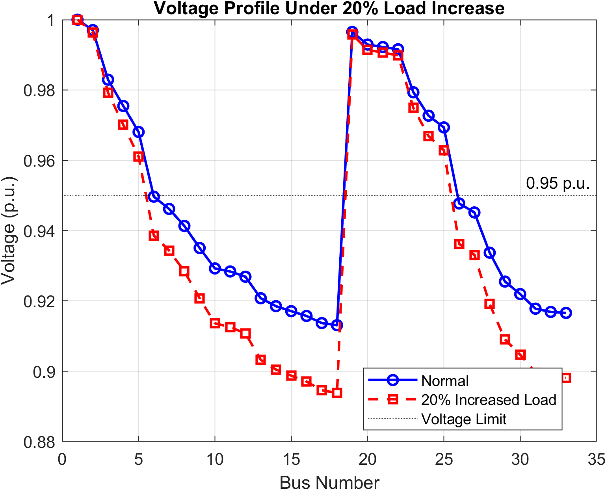
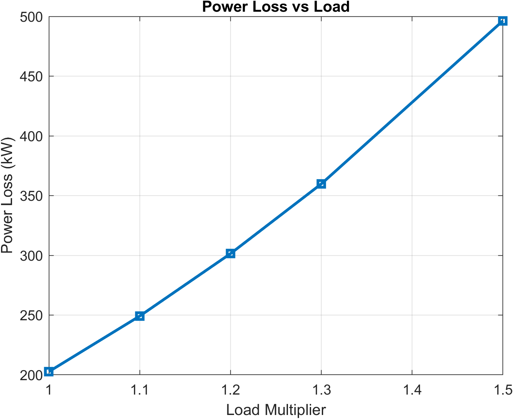
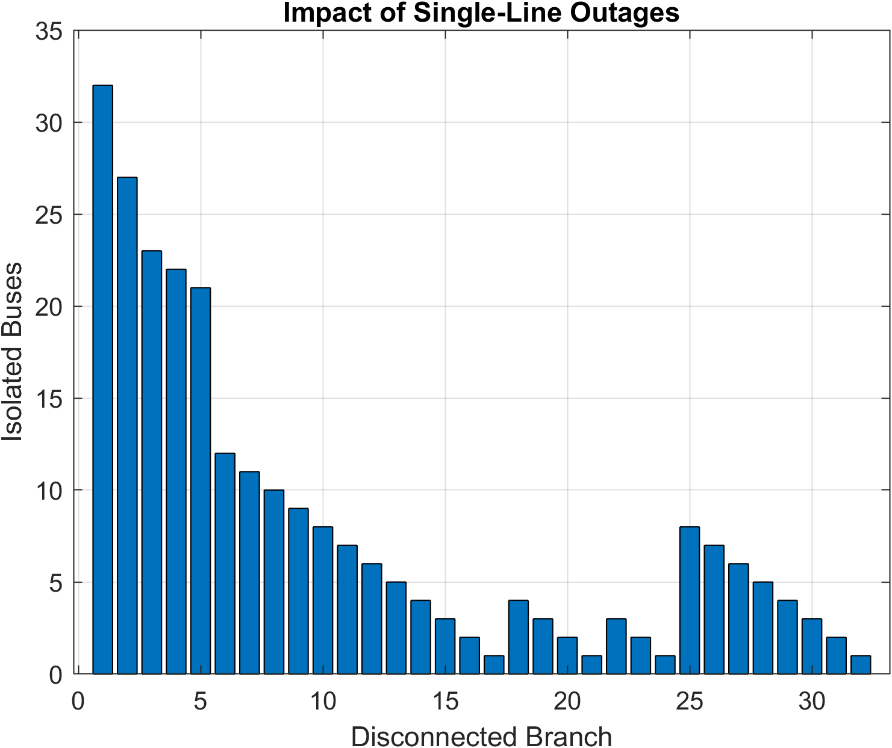
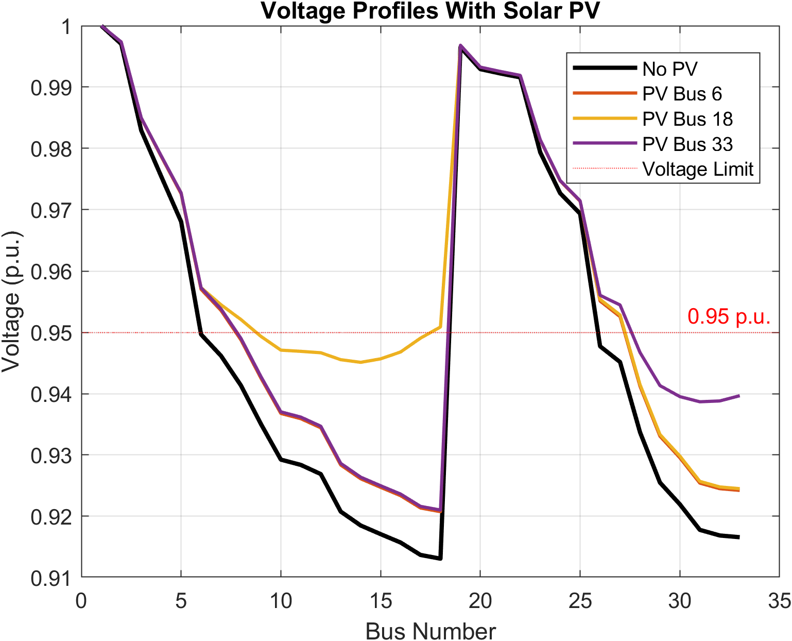
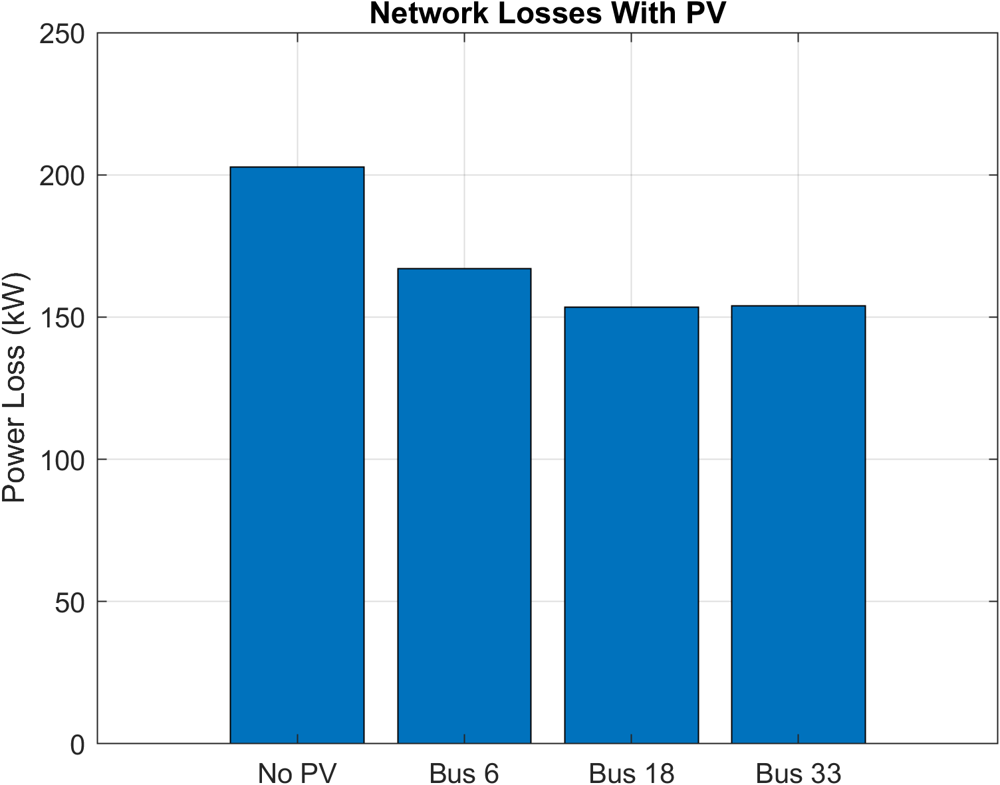
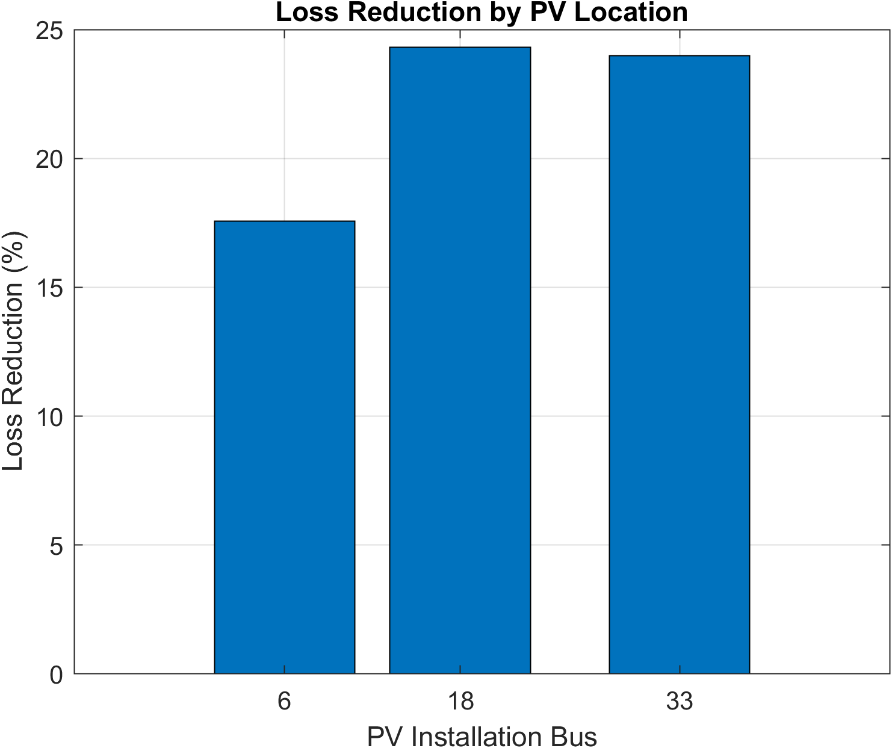

# IEEE 33-Bus Distribution Network Analysis

**MATLAB | MATPOWER 8.1 | AC Power Flow | Network Reconfiguration | Solar PV Integration**

## Project Overview

This project investigates the steady-state performance of the IEEE 33-bus radial distribution network using MATLAB and MATPOWER 8.1.

The study evaluates how increasing electricity demand, feeder outages, network restoration and distributed solar photovoltaic (PV) generation affect voltage profiles, active-power losses and network connectivity.

The objective is to develop practical experience in distribution-system modelling, power-flow simulation and renewable energy integration.

## Project Objectives

- Analyze voltage profiles and identify weak buses.
- Evaluate active-power losses under different loading conditions.
- Investigate the impact of single-line outages on network connectivity.
- Evaluate network restoration using normally open tie switches.
- Compare distributed solar PV installation at different buses.
- Validate simulation convergence and selected engineering conditions.

## Tools and Technologies

- **MATLAB** — simulation, analysis and visualization
- **MATPOWER 8.1** — AC power-flow calculations
- **Graph Theory** — network connectivity and radiality analysis
- **CSV** — simulation data export and comparison

## Network Model

The project uses the IEEE 33-bus radial distribution benchmark (`case33bw`) available in MATPOWER.

The network contains 33 buses, 32 initially closed branches and five normally open tie switches.

## Simulation Methodology

### 1. Base-Case Power Flow

Performed AC power-flow analysis to establish reference voltage profiles and network active-power losses.

### 2. Load Disturbance Analysis

Investigated a 20% increase in active and reactive power demand to evaluate voltage reduction and increased network losses.

### 3. Multiple Loading Scenarios

Evaluated five demand multipliers: 1.0, 1.1, 1.2, 1.3 and 1.5.

Compared minimum voltage, active-power losses and undervoltage bus counts.

### 4. Single-Line Contingency Analysis

Opened each initially closed feeder branch individually and used graph-based connectivity analysis to identify buses disconnected from the source.

### 5. Network Restoration

Investigated restoration following the opening of branch 7 by evaluating normally open tie switches.

Candidate configurations were screened for network connectivity, radiality and AC power-flow convergence.

### 6. Solar PV Integration

Simulated 500 kW solar PV generation at buses 6, 18 and 33.

PV generation was represented as a fixed active-power injection at unity power factor using a negative net-demand model.

## Simulation Results

### Engineering Validation

All six implemented simulation validation checks passed:

- Base-case consistency
- Convergence of all load scenarios
- Coverage of initially closed branches
- Identification of at least one restoration configuration
- Convergence of all PV scenarios
- Identification of at least one PV scenario reducing losses

These checks do not establish complete operational or grid-code compliance.

### Solar PV Integration Results

| PV Location | Minimum Voltage (p.u.) | Network Losses (kW) | Loss Reduction (%) |
|---|---:|---:|---:|
| Bus 6 | 0.9208 | 167.08 | 17.56 |
| **Bus 18** | **0.9245** | **153.42** | **24.30** |
| Bus 33 | 0.9210 | 154.05 | 23.99 |

**Key Finding:** Among the three tested PV locations, Bus 18 achieved the greatest active-power loss reduction of **24.30%**, reducing network losses to **153.42 kW**.

Although PV improved network performance, the minimum voltage remained below the 0.95 p.u. screening threshold, indicating that further voltage-support measures would be required to eliminate all undervoltage violations.

## Simulation Visualizations

### Voltage Profiles Under Load Disturbance



### Power Loss Sensitivity



### Single-Line Outage Analysis



### Solar PV Voltage Profiles



### Solar PV Network Loss Comparison



### Solar PV Loss Reduction



## Project Structure

```text
IEEE-33-Bus-Power-System-Analysis/
|
|-- disturbance_analysis.m
|-- README.md
|-- .gitignore
|
|-- figures/
|   |-- 15 simulation graphs
|
|-- results/
    |-- load_disturbance_results.csv
    |-- line_outage_results.csv
    |-- network_restoration_results.csv
    |-- solar_pv_results.csv
    |-- validation_results.csv
```

## How to Run

1. Install MATLAB and MATPOWER 8.1.
2. Add MATPOWER to the MATLAB search path.
3. Download or clone this repository.
4. Open `disturbance_analysis.m` in MATLAB.
5. Run the script.
6. Review the generated figures and CSV results.

## Engineering Limitations

- The study uses steady-state AC power flow rather than transient stability simulation.
- Fault-current calculations and protection coordination are not included.
- PV generation is modelled as fixed active-power injection without detailed inverter controls.
- Restoration screening does not establish complete switching or protection feasibility.
- Voltage screening alone is insufficient to establish full grid-code compliance.

## Future Improvements

- PV hosting-capacity analysis
- Reactive-power compensation and voltage regulation
- Time-series simulation with variable solar generation
- Thermal loading and branch constraint evaluation
- Automated network reconfiguration optimization

## Acknowledgement

This project uses the `case33bw` benchmark distributed with MATPOWER. The benchmark and MATPOWER software remain subject to their respective attribution and licensing requirements.

## References

1. **Baran, M. E., and Wu, F. F. (1989).** "Network Reconfiguration in Distribution Systems for Loss Reduction and Load Balancing." *IEEE Transactions on Power Delivery*, 4(2), 1401–1407. https://doi.org/10.1109/61.25627

2. **Zimmerman, R. D., Murillo-Sánchez, C. E., and Thomas, R. J. (2011).** "MATPOWER: Steady-State Operations, Planning, and Analysis Tools for Power Systems Research and Education." *IEEE Transactions on Power Systems*, 26(1), 12–19. https://doi.org/10.1109/TPWRS.2010.2051168

3. **MATPOWER Documentation.** MATPOWER 8.1 User's Manual and `case33bw` benchmark case. Available at: https://matpower.org/

## Attribution

This project uses the IEEE 33-bus distribution benchmark provided through MATPOWER (`case33bw`). The MATLAB scripts for load disturbance analysis, contingency screening, network restoration and solar PV integration were developed for this project.

The benchmark model and MATPOWER software are attributed to their respective original authors. The simulation results presented in this repository were generated using MATLAB and MATPOWER.
